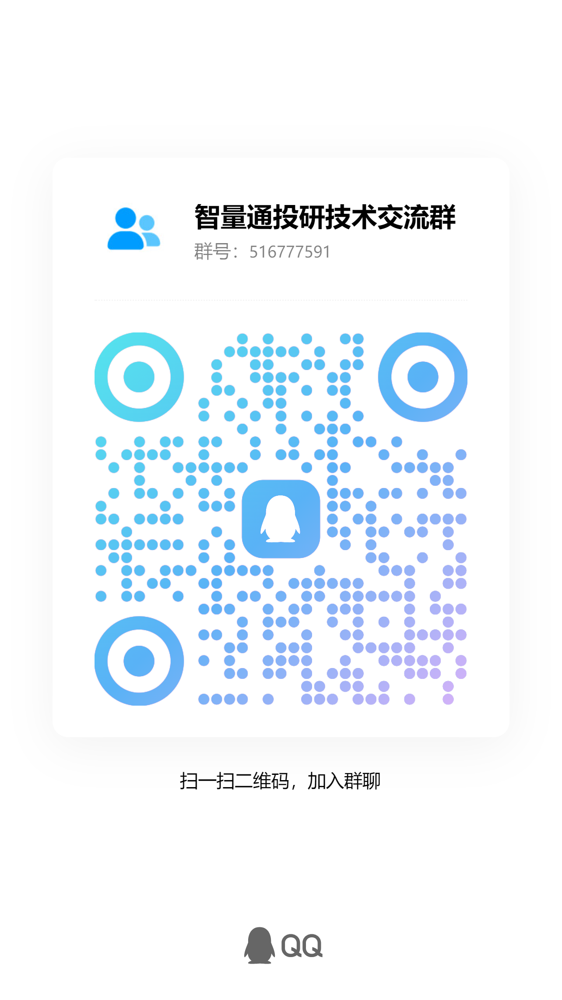

# 智量通 ZLT Quant

面向 AI Agent 与 Python 开发者的量化投研工具：行情查询、数据准备、策略开发、因子研究与本地回测。

[获取 Skill](https://skillhub.cn/skills/org-gir79457/zlt-quant) · [npm 工具包](https://www.npmjs.com/package/@zltquant/zlt-mcp) · [使用文档](https://docs.zltquant.com/) · [数据与手册](#数据与手册) · [交流与支持](#交流与支持)

通过 Skill、CLI 或 MCP 接入智量通，也可以在配套研究环境中编写 Python 策略。本仓库提供产品介绍、安装指引和文档导航。

## 主要功能

| 功能 | 可以做什么 |
| --- | --- |
| 行情查询 | 查看 A 股大盘、个股盘口、分时、资金动向与龙头观察面板 |
| 数据准备 | 查看云端数据目录、本地覆盖与缺口，按需下载回测数据 |
| 策略开发 | 获取官方模板，创建、编写或迁移 Python 策略 |
| 本地回测 | 运行股票、场内基金、可转债和期货回测，分析收益、委托与报告 |
| 因子研究 | 创建因子、计算因子值，查看 IC、分层收益和换手率等检测结果 |

## 运行环境

| 使用方式 | 环境要求 |
| --- | --- |
| Skill / CLI / MCP | Node.js 20 或更高版本；Windows x64 或 macOS |
| AI Agent | 支持 Skills 并能运行终端命令，或支持 MCP 的客户端 |
| 本地研究与回测 | 配套 ClientLite 研究环境；当前自动安装流程支持 Windows x64、macOS ARM64 |

行情面板查询无需安装本地回测环境。Python SDK 使用配套研究环境，安装与平台要求见 [npm 文档](https://www.npmjs.com/package/@zltquant/zlt-mcp?activeTab=readme) 和 [终端安装手册](https://docs.zltquant.com/instructions/terminal-intro.html)。

## 安装方法

### 在 AI Agent 中安装 Skill

适用于 Codex、WorkBuddy 等支持 Skills 的 Agent。打开 [SkillHub 页面](https://skillhub.cn/skills/org-gir79457/zlt-quant)，或将下面的内容发送给 Agent：


```text
请根据 https://skillhub.cn/install/skillhub.md，安装 @org-gir79457/zlt-quant。
```

安装完成后，在新会话中描述任务，Skill 会引导登录和环境准备。

### 在终端中安装 CLI


```sh
npm install --global @zltquant/zlt-mcp
zlt-mcp auth login
```

按提示在浏览器中完成登录授权，再查看可用工具：


```sh
zlt-mcp list
zlt-mcp list --tool show_stock_panel --json
```

### 接入 MCP 客户端

先完成上面的登录，再在客户端添加配置。Windows 示例：


```json
{
  "mcpServers": {
    "zlt-quant": {
      "command": "npx.cmd",
      "args": ["-y", "@zltquant/zlt-mcp"]
    }
  }
}
```

macOS 将 `npx.cmd` 改为 `npx`。配置位置和生效方式以所用客户端说明为准。

## 使用示例

### 查询 A 股行情

在 Agent 中提出任务：


```text
用智量通查看今天 A 股大盘行情，说明涨跌分布和成交额，保留数据时间。
```

也可以直接在终端调用：


```sh
zlt-mcp call show_market_panel
```

### 查看数据目录


```text
用智量通 MCP 查看沪深股票、指数、基金和期货的云端数据目录，
列出可用类别与日期范围。先只读查询。
```

云端目录与本地已下载数据分别核对：`mcp-get-cloud-data-list` 查看云端，`mcp-get-data-range` 查看本地覆盖。目录中的日期边界不代表每只证券都有连续历史。

### 运行一次回测


```text
用智量通官方交易模板，对平安银行做一次日线回测，初始资金 100 万。
先核对数据覆盖；安装环境或下载数据前，说明范围并让我确认。
完成后打开报告，解释收益、回撤和结果限制。
```

本地回测支持沪深 A 股、场内基金、可转债和期货；北交所与期权暂不支持。品种与交易规则见 [回测说明](https://docs.zltquant.com/api/zltquant/backtest-and-migration.html)。

### 使用 Python 读取历史行情

在已完成配置的智量通研究环境中运行。示例依据官方 SDK 文档，初始化和查询可能按环境配置补充本地数据。


```python
from zltquant import init_research, get_price

context = init_research(
    start_time="2024-01-01",
    end_time="2024-06-30",
)

prices = get_price(
    "sz000001",
    start_date="2024-06-01",
    end_date="2024-06-28",
    frequency="daily",
    fields=["time", "open", "high", "low", "close", "volume"],
    df=True,
)
print(prices.tail())
```

`df=True` 返回 DataFrame；未指定时默认返回 NumPy 结构化数组。完整频率、复权和时间参数见 [行情数据接口](https://docs.zltquant.com/api/zltquant/api/functions/market-data.html)。

## 数据与手册

数据准备接口按市场和数据类型组织，实际可用范围以当前工具、账号权限及查询结果为准。

| 数据类别 | 内容 |
| --- | --- |
| 股票、债券、基金、指数 | 日线、分钟线与快照类别；各市场实际覆盖分别查询 |
| 期货 | 五个期货交易所的行情类别，研究时另需核对合约与交易规则 |
| 财务 | 专业财务、核心财务 |
| ETF 专项 | 与基金行情分开查询的 ETF 数据类别 |
| 市场规则 | 保证金、持仓限额、交割费用等规则类别 |

| 我想做什么 | 文档入口 |
| --- | --- |
| 了解 CLI 和 MCP | [npm 使用说明](https://www.npmjs.com/package/@zltquant/zlt-mcp?activeTab=readme) |
| 编写第一个策略 | [SDK 快速开始](https://docs.zltquant.com/api/zltquant/api/functions/getting-started.html) |
| 查询历史行情 | [行情数据接口](https://docs.zltquant.com/api/zltquant/api/functions/market-data.html) |
| 查询财务数据 | [财务数据接口](https://docs.zltquant.com/api/zltquant/api/financial-data/01-get_fundamentals.html) |
| 研究因子 | [因子接口与示例](https://docs.zltquant.com/api/zltquant/api/functions/factor.html) |
| 参考完整策略 | [策略示例](https://docs.zltquant.com/api/zltquant/api/strategy-examples.html) |
| 使用 VS Code 插件 | [zlt-claw 使用手册](https://docs.zltquant.com/vscode/) |
| 使用投研终端 | [终端简介](https://docs.zltquant.com/instructions/terminal-intro.html) · [投研模块](https://docs.zltquant.com/instructions/research-module.html) |

[浏览官方知识库](https://docs.zltquant.com/)。SDK、终端、插件与 MCP 分别以对应版本文档为准。

## 版本与更新

- [CLI / MCP 版本记录](https://www.npmjs.com/package/@zltquant/zlt-mcp?activeTab=versions)
- [投研终端更新说明](https://docs.zltquant.com/instructions/update-notes.html)
- [VS Code 插件更新日志](https://docs.zltquant.com/vscode/CHANGELOG.html)

## 常见问题

**查询行情和运行回测，需要同一套环境吗？**

行情面板查询无需本地回测环境；本地回测需要准备 ClientLite 研究环境和对应数据。

**云端有数据，为什么本地仍无法回测？**

云端目录不代表本地已下载。先检查本地覆盖、标的、日期与频率，再准备所需数据；拿到任务 ID 后，应继续等待任务完成。

**克隆这个仓库就能直接运行吗？**

本仓库提供介绍和文档。请通过上面的 SkillHub 或 npm 入口安装工具，再按手册准备研究环境。

更多问题见 [回测与迁移说明](https://docs.zltquant.com/api/zltquant/backtest-and-migration.html)。

## 交流与支持

欢迎加入 **智量通投研技术交流群**，交流安装配置、使用问题和量化研究经验。

**QQ 群号：516777591**。可使用 QQ 扫描下方二维码，或搜索群号申请加入。



也可以通过 [GitHub Issues](https://github.com/zlt-quant/zlt-quant/issues) 反馈问题。请附上工具版本、使用环境、复现步骤和错误信息，并去除密码、token 等敏感内容。

## 使用说明

可用数据与功能以当前版本、账号权限及平台实际返回为准。回测和研究结果仅供研究参考，不构成投资建议，历史表现不代表未来收益。

智量通专有组件限个人、非商业研究使用；商用需另行书面授权。具体以相应组件随附的产品许可及第三方声明为准。公开文档不授予财经数据转售或再分发权限。
